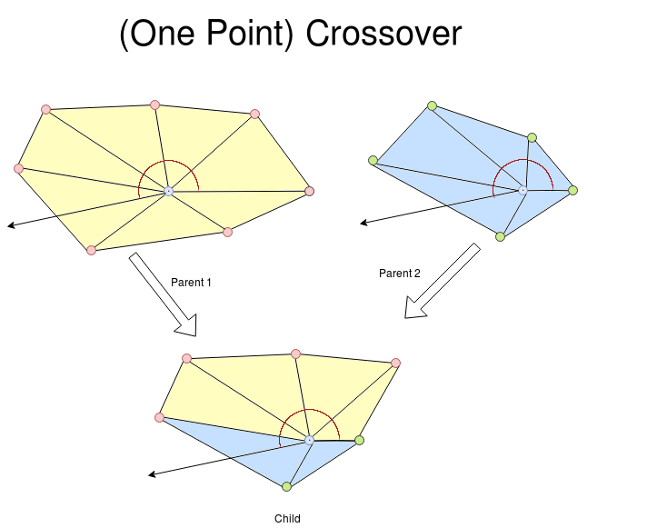
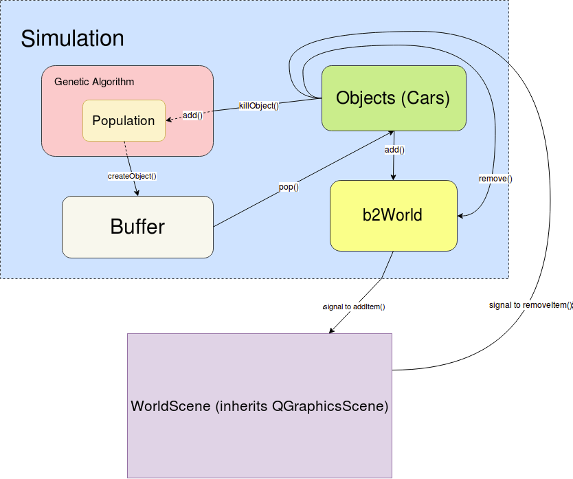

# CarSimulation

Cars that learn to drive over a randomly generated, hilly track by evolution. Each car is a random polygon with two wheels, simulated with [Box2D](https://github.com/erincatto/Box2D). The further a car gets, the more likely it is to pass its genes on. After a few generations the population is full of cars that are much better at it than the random ones it started with.

Written in C++ with Qt.

## The car


A car has three parts: a body and two wheels. The body is a polygon built from body genes. Each gene stores one vertex relative to the center, together with the physical parameters of that piece of the body: density, friction and restitution. The number of vertices is random, so cars differ not only in proportions but also in shape. Each wheel gene stores the radius, the physical parameters and the vertex the wheel is attached to.

## Evolution

Every generation goes through selection, crossover and mutation, and the new cars are then tested in the simulation.



Crossing two bodies works on angles. The vertices of each parent are sorted by their angle around the center, a random cut angle is drawn (red in the picture), and the child gets the vertices below the cut from one parent and the rest from the other. Two-point crossover does the same with two cut angles. Wheels have their own crossover, and both bodies and wheels have their own mutations.

Selection is roulette (by fitness or by rank) or tournament.

## Simulation



The world runs in its own thread and is drawn on a `QGraphicsScene`. New cars wait in a buffer. A car is removed when it stops moving, crashes or leaves the track, and the next one from the buffer takes its place.

When you create a new world you can set gravity, world size, buffer size, time limit, population size, the selection type and the probability of each genetic operator.

More details, with UML class diagrams, are in [docs/CarSimulation.pdf](docs/CarSimulation.pdf) (in Polish) and [docs/DPietruchowski_diagram.pdf](docs/DPietruchowski_diagram.pdf).

## Building

You need Qt 4.8 or Qt 5 (with the OpenGL module) and Box2D 2.x.

Install Box2D:

```bash
cd $BOX2DPATH/Build/Box2D
cmake -DBOX2D_INSTALL=ON -DBOX2D_BUILD_SHARED=ON ..
make && make install
```

Then build the app:

```bash
mkdir build && cd build
qmake ../src/CarSimulation.pro
make
```

If qmake can't find OpenGL or Box2D, add the paths in `src/CarSimulation.pro`:

```
INCLUDEPATH += /usr/include/qt5/QtOpenGL
LIBS += -lBox2D
```
