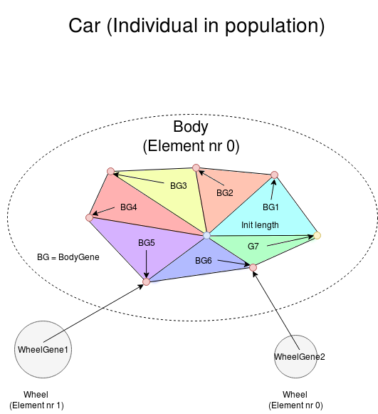

# CarSimulation

A C++ application that evolves cars using a genetic algorithm, built with [Box2D](https://github.com/erincatto/Box2D) for physics simulation and Qt for the GUI.

Each car is an individual in a population. Cars with greater distance traveled score higher fitness and are more likely to reproduce. Over generations, the population evolves better-adapted vehicles.

## How it works

### Car representation

A car consists of three physical elements:

- **Body** — a polygon defined by up to 6 `BodyGene`s, each encoding a vertex position relative to the center
- **2 Wheels** — circles defined by `WheelGene`s, each encoding radius and the body vertex they attach to

Both gene types inherit from `Gene` and carry physics parameters (density, friction, restitution).



### Genetic algorithm

Each generation runs Selection → Crossover → Mutation → evaluate in simulation.

**Selection** — two strategies available:
- *Roulette selection* — probability proportional to fitness score
- *Tournament selection* — best of a random subset

**Crossover** — two strategies for body genes:
- *One-point crossover* — vertices sorted by angle; a random cut angle splits genes from parent 1 vs parent 2
- *Two-point crossover* — two cut angles define three segments alternating between parents

Wheel genes use `WheelCrossover`. Body genes use `BodyMutation` and `WheelMutation` for mutation.


### Architecture

The `World` runs in a separate thread and drives the `Simulation`, which manages:

- **`GeneticAlgorithm`** — population, selection, crossover/mutation generators
- **`b2World`** — Box2D physics world
- **`Buffer`** — queue of newly created cars waiting to enter the simulation
- **`Objects`** — active cars currently being simulated
- **`WorldScene`** — Qt `QGraphicsScene` used for rendering


See [`docs/DPietruchowski_diagram.pdf`](docs/DPietruchowski_diagram.pdf) for full UML class diagrams and [`docs/CarSimulation.pdf`](docs/CarSimulation.pdf) for a detailed description of the genome and crossover operators.

## Dependencies

- **Qt 5** (tested with 5.7)
- **Box2D** — [https://github.com/erincatto/Box2D](https://github.com/erincatto/Box2D)

## Building

Install Box2D:

```sh
cd $BOX2DPATH/Build/Box2D
cmake -DBOX2D_INSTALL=ON -DBOX2D_BUILD_SHARED=ON ..
make && make install
```

Then build the project:

```sh
cd build
qmake ../src/CarSimulation.pro
make
```

If the build fails, open `src/CarSimulation.pro` and verify that the include path for Qt OpenGL and the Box2D shared library are set correctly:

```
INCLUDEPATH += /usr/include/qt5/QtOpenGL
LIBS += -lBox2D
```
